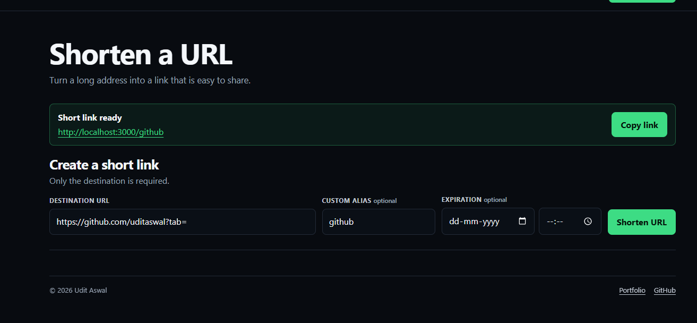
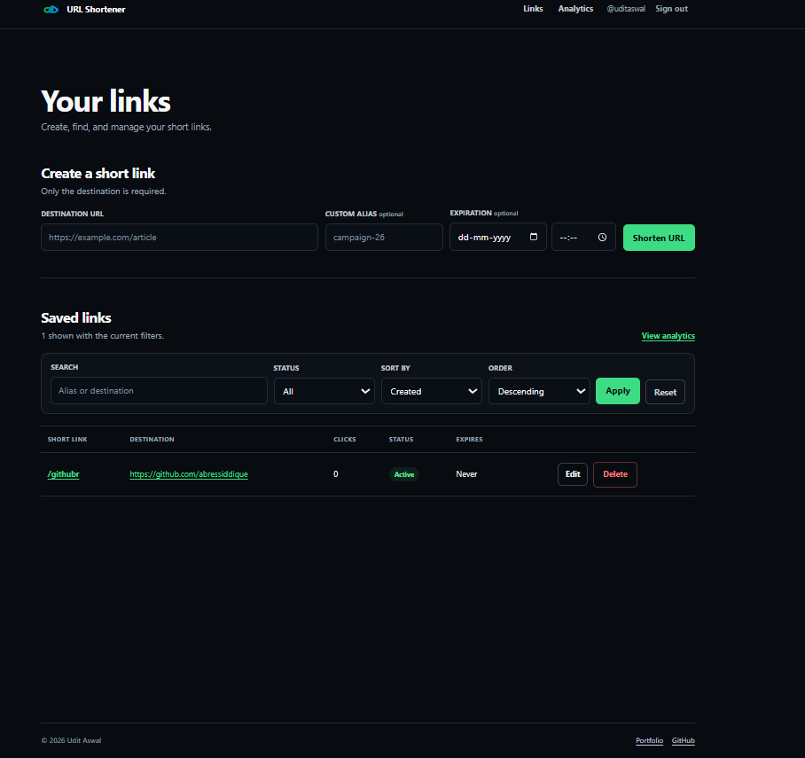

# URL Shortener

A full-stack URL shortener built with Node.js, Express, MongoDB, and server-rendered EJS. It supports guest links, account-based link management, expiration, click analytics, admin moderation, and a documented JSON API.

[Live demo](https://url-shortner-ugkr.onrender.com/) · [Source code](https://github.com/uditaswal/url-shortner) · [Run locally](#run-locally) · [API documentation](#api-documentation)

## Screenshots

### Create a short link



### Manage saved links



## What It Does

Visitors can shorten a URL without creating an account. Registered users get a private dashboard where they can search, filter, edit, disable, and delete their links. Each link may use a generated or custom alias and can expire at a chosen date and time.

Redirects record visit information for analytics. Known bot traffic is separated from human visits, and signed-in users can review totals and country distribution. Administrators can disable links that violate the service rules.

The same application serves both the browser interface and a JSON API. Swagger UI documents the API and supports sending requests directly from the browser.

## Features

- Guest and account-based URL shortening
- Generated or custom short aliases
- Optional expiration date and time
- Account-scoped link dashboard
- Search, status filtering, and sorting
- Link editing, disabling, and deletion
- Human and bot visit counts
- Country-level visit summaries
- Administrator moderation
- Interactive OpenAPI documentation with copyable examples
- Privacy, terms, acceptable-use, and abuse-reporting pages
- Request logging, health checks, rate limiting, and CI

## Architecture

```text
Browser or API client
        |
        v
Express route layer
  /ui/*       browser pages and forms
  /api/*      JSON API
  /:shortId   public redirect
        |
        v
Middleware
  authentication -> validation -> rate limiting -> request logging
        |
        v
Controllers
  link lifecycle -> dashboard queries -> analytics -> moderation
        |
        v
Mongoose models
  users -> URLs -> separate visit events -> rate-limit records
        |
        v
MongoDB
```

The UI and API share controllers, validation, authentication, and persistence rather than maintaining separate implementations. EJS renders the browser experience on the server, while API routes return JSON for external clients.

The main route groups are:

- `/ui/*` for browser pages and form submissions
- `/api/*` for REST and JSON responses
- `/:shortId` for public redirects
- Legacy paths such as `/`, `/profile`, `/login`, and `/user/*` for backward compatibility

## Technical Decisions and Tradeoffs

### Server-rendered UI

EJS keeps the project small and lets the browser UI reuse the same Express application as the API. It avoids a separate frontend build and deployment, but it offers less client-side interactivity than a dedicated SPA.

### Separate, best-effort visit analytics

New visit records live in a separate indexed collection, so a popular short link does not grow into an unbounded MongoDB document. Redirects do not wait for analytics persistence: if a visit write fails, the error is logged and the visitor still reaches the destination. This deliberately prioritises redirect availability over perfect analytics delivery; a queue or event stream would be the next step when lossless tracking becomes a requirement.

### Signed authentication tokens with database validation

Authentication uses a signed token in an HTTP-only cookie. Each request also resolves the user from MongoDB and checks a token version, which supports invalidating old sessions and reflecting role changes. The additional lookup is a deliberate consistency and control tradeoff.

### Database-backed rate limiting

Rate-limit records are shared through MongoDB instead of living only in process memory. This works across multiple application instances, but every protected request adds database work. Redis or another dedicated store would be a better fit at higher request volumes.

### Heuristic bot detection

Bot visits are identified from request signals such as the user agent. This keeps analytics useful without adding a third-party service, but the result is approximate because clients can omit or spoof those signals.

### Compatibility routes

Canonical `/ui/*` and `/api/*` routes coexist with older paths. This avoids breaking existing links while the routing structure evolves, at the cost of carrying additional route aliases that can be removed in a future breaking release.

## Tech Stack

- **Runtime:** Node.js 24 LTS
- **Web framework:** Express 5
- **Views:** EJS and CSS
- **Database:** MongoDB with Mongoose
- **Authentication:** JSON Web Tokens and bcrypt
- **Security:** Helmet, Content Security Policy, server-side validation, and express-rate-limit
- **Logging:** Winston with rotating log files plus structured stdout in deployed environments
- **API documentation:** Swagger UI and OpenAPI annotations
- **Testing:** Supertest with a MongoDB-backed integration scenario
- **Tooling:** pnpm, ESLint, Prettier, and Nodemon
- **CI:** GitHub Actions with a MongoDB service container

## Run Locally

### Prerequisites

- Node.js 24 LTS
- pnpm
- A local MongoDB server or a MongoDB connection string

Enable pnpm through Corepack if it is not already installed:

```bash
corepack enable
```

### 1. Clone and install

```bash
git clone https://github.com/uditaswal/url-shortner.git
cd url-shortner
pnpm install
```

### 2. Configure the environment

Copy [`.env.example`](./.env.example) to `.env`.

PowerShell:

```powershell
Copy-Item .env.example .env
```

macOS or Linux:

```bash
cp .env.example .env
```

Set the test and production values in `.env`:

```env
PORT=3000
APP_ENV=test

TEST_DB_URL=mongodb://127.0.0.1:27017/
TEST_DB_NAME=url-shortner-test
TEST_DB_ACCOUNT=local-test-user
TEST_JWT_SECRET_KEY=replace-with-a-long-random-secret

PROD_DB_URL=mongodb://127.0.0.1:27017/
PROD_DB_NAME=url-shortner-prod
PROD_DB_ACCOUNT=local-prod-user
PROD_JWT_SECRET_KEY=replace-with-a-different-production-secret
```

When `APP_ENV=test`, the application reads the `TEST_*` variables. When `APP_ENV=production`, it reads the `PROD_*` variables.

### 3. Check the database connection

```bash
pnpm db:check
```

### 4. Start the application

Development mode with automatic restarts:

```bash
pnpm dev
```

Normal start:

```bash
pnpm start
```

The terminal prints the address when the server is ready:

```text
URL Shortener started at http://localhost:3000/
```

Open [http://localhost:3000](http://localhost:3000) in a browser.

## API Documentation

With the application running, open [http://localhost:3000/api/api-docs](http://localhost:3000/api/api-docs). The documentation covers authentication, URL creation and management, analytics, moderation, dashboard data, and health checks.

Example health check:

```bash
curl http://localhost:3000/api/health
```

```json
{
    "status": "UP",
    "timestamp": "2026-05-09T12:00:00.000Z"
}
```

## Testing and CI

Run the project checks locally:

```bash
pnpm lint
pnpm test:unit
pnpm test
```

The integration scenario covers signup, login, guest and authenticated link creation, custom aliases, expiration, redirects, bot filtering, analytics, editing, moderation, logout, and deletion.

The test clears URL, user, and rate-limit records in `TEST_DB_NAME` before and after execution. Always use a dedicated disposable test database.

GitHub Actions runs lint and the integration scenario for pushes and pull requests targeting `main` or `dev`. Every CI run starts a fresh MongoDB service container and uses a run-specific database.

## Useful Commands

```text
pnpm dev        Start the development server with automatic restarts
pnpm start      Start the application normally
pnpm db:check   Verify database connectivity without changing data
pnpm lint       Check JavaScript and EJS files
pnpm lint:fix   Apply supported lint fixes
pnpm format     Format supported source files
pnpm test:unit  Run database-free reliability checks
pnpm test:integration Run the MongoDB-backed integration scenario
pnpm test       Run unit checks followed by the integration scenario
```

## Project Structure

```text
controller/          Route handlers and application workflows
docs/screenshots/    README screenshots
middleware/          Authentication, logging, validation, and rate limiting
model/               Mongoose schemas and indexes
public/              Styles, scripts, and image assets
routes/              API, UI, redirect, and compatibility routes
scripts/             Local utility scripts
test/                End-to-end integration scenario
util/                Configuration, authentication, logging, and helpers
views/               EJS templates and shared partials
```
